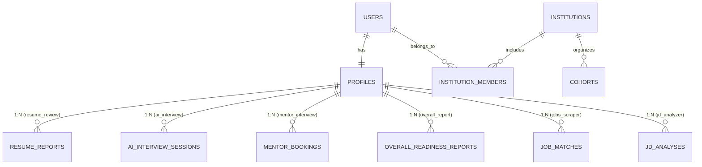

# Microservices Architecture & Integration Plan — PrepPilot

> **Purpose**: This document serves as the single source of truth for the microservice decomposition, shared database architecture, and integration roadmap for the PrepPilot platform. Every team member working on an individual service should reference this architecture to maintain strict service isolation, consistent data models, and clean API contracts.

---

## 1. High-Level Architecture Overview

PrepPilot is transitioning from a monolithic backend into a **Microservice-Oriented Architecture** designed around domain-driven bounded contexts.

```
                                  ┌───────────────────────────────┐
                                  │   Next.js 16 Client Portal    │
                                  │      (App Router, UI)         │
                                  └───────────────┬───────────────┘
                                                  │ REST / SSE
                                                  ▼
                                  ┌───────────────────────────────┐
                                  │  API Gateway & Auth Router    │
                                  │  (JWT verify, Rate limiting)  │
                                  └───────┬───────────────┬───────┘
                                          │               │
     ┌───────────────────┬────────────────┼───────────────┼───────────────────┬───────────────────┐
     ▼                   ▼                ▼               ▼                   ▼                   ▼
┌──────────────┐  ┌──────────────┐ ┌──────────────┐ ┌──────────────┐   ┌──────────────┐   ┌──────────────┐
│  1. Mentor   │  │    2. AI     │ │  3. Resume   │ │  4. Overall  │   │ 5. Suggested │   │  6. JD &     │
│  Interview   │  │  Interview   │ │    Review    │ │    Report    │   │ Jobs Scraper │   │  Interview   │
│   Service    │  │   Service    │ │  (Isolated)  │ │   Service    │   │   Service    │   │    Design    │
└──────┬───────┘  └──────┬───────┘ └──────┬───────┘ └──────┬───────┘   └──────┬───────┘   └──────┬───────┘
       │                 │                │                │                  │                  │
       └─────────────────┴────────────────┼────────────────┴──────────────────┴──────────────────┘
                                          │
                                          ▼
                         ┌─────────────────────────────────┐
                         │    7. Connected Teams Prep      │
                         │    (University/Cohorts B2B)     │
                         └────────────────┬────────────────┘
                                          │
                                          ▼
                      ┌───────────────────────────────────────┐
                      │    PostgreSQL Database (Supabase)     │
                      │  - Shared: users, profiles, teams     │
                      │  - Dedicated table per microservice   │
                      └───────────────────────────────────────┘
```

### Free-Tier Hosting & Deployment Strategy
To remain strictly within a **\$0 budget** while ensuring clean architectural boundaries:
- **Modular Monorepo Structure**: All services reside in `/backend/services/<service-name>`, isolated with their own Pydantic schemas, business logic, and database models.
- **Microservice Ready**: Each service is stateless and can be launched as an autonomous container (`Dockerfile` per service) or orchestrated together behind the FastAPI API Gateway for single-instance hosting on Render/Railway free tier.

---

## 2. Shared Database Strategy (PostgreSQL / Supabase)

To enable independent development without data duplication or tight coupling, the platform uses a **Shared Core + Dedicated Service Tables** pattern.

### 2.1 Shared Core Schema (`public`)
All shared entities that define identity and user attributes live in the core schema. Common candidate attributes (target role, experience tier, core skills) are stored centrally in `profiles` so microservices do not maintain duplicate user state.



#### Core Tables
- **`users`**:
  - `id`: UUID (Primary Key, Supabase Auth user ID)
  - `email`: VARCHAR (unique, indexed)
  - `role`: VARCHAR (`candidate` | `mentor` | `team_admin` | `super_admin`)
  - `created_at`: TIMESTAMPTZ
- **`profiles`**:
  - `id`: UUID (Primary Key)
  - `user_id`: UUID (Foreign Key `users.id`, unique, indexed)
  - `full_name`: VARCHAR
  - `avatar_url`: VARCHAR (nullable)
  - `target_role`: VARCHAR (e.g., "Frontend Engineer", "Data Scientist")
  - `experience_level`: VARCHAR (`junior` | `mid` | `senior`)
  - `bio`: TEXT
  - `target_companies`: TEXT[] (array of company names)
  - `skills`: JSONB (categorized skills array)
  - `created_at`, `updated_at`: TIMESTAMPTZ
- **`institutions`**:
  - `id`: UUID (Primary Key)
  - `name`: VARCHAR (e.g., "Stanford University", "CodePath")
  - `type`: VARCHAR (`university` | `bootcamp` | `corporate`)
  - `admin_user_id`: UUID (Foreign Key `users.id`)
  - `created_at`: TIMESTAMPTZ
- **`institution_members`**:
  - `id`: UUID (Primary Key)
  - `institution_id`: UUID (Foreign Key `institutions.id`)
  - `user_id`: UUID (Foreign Key `users.id`)
  - `batch_name`: VARCHAR (e.g., "Class of 2026")
  - `status`: VARCHAR (`active` | `graduated` | `pending`)
  - `joined_at`: TIMESTAMPTZ

---

## 3. Microservice Specifications

Every service operates on its own dedicated database tables, referencing `user_id` or `profile_id`.

### Service 1: Mentor Interview Service
- **Role**: Peer & industry professional mock interview marketplace.
- **Responsibilities**:
  - Mentor application, credential verification, and admin approval.
  - Weekly slot calendar management & candidate booking.
  - Jitsi Meet room generation (`preppilot-mentor-<booking_id>`).
  - Structured mentor feedback form submission (Communication, Technical, Problem Solving, 1-10 scores + written review).
- **Dedicated Tables**:
  - `mentor_profiles`: `id`, `user_id` (FK), `domains` (text[]), `company`, `title`, `years_experience`, `hourly_rate_or_credits`, `is_approved`, `avg_rating`
  - `mentor_availability`: `id`, `mentor_id` (FK), `start_time`, `end_time`, `is_booked`
  - `mentor_bookings`: `id`, `candidate_id` (FK), `mentor_id` (FK), `slot_id` (FK), `status` (`scheduled`|`completed`|`cancelled`|`no_show`), `jitsi_room_name`
  - `mentor_feedbacks`: `id`, `booking_id` (FK), `communication_score`, `technical_score`, `problem_solving_score`, `comments`, `created_at`
- **Key Endpoints**:
  - `GET /api/mentors` (browse & filter by domain/company)
  - `GET /api/mentors/{id}/slots` (available calendar slots)
  - `POST /api/mentors/bookings` (create booking)
  - `POST /api/mentors/feedback` (submit structured evaluation)

### Service 2: AI Mock Interview Service
- **Role**: Instant, 24/7 AI-led conversational interview simulator.
- **Responsibilities**:
  - Domain & difficulty selection (DSA, System Design, Behavioral, Frontend, etc.).
  - Conversational question-and-answer loop (audio or text).
  - Contextual follow-up generation based on candidate's previous response and resume context.
  - Multi-pillar scoring and final session report generation.
- **Dedicated Tables**:
  - `ai_interview_sessions`: `id`, `user_id` (FK), `target_role`, `domain`, `status`, `overall_score`, `transcript` (JSONB), `rubric_breakdown` (JSONB), `started_at`, `ended_at`
  - `ai_interview_turns`: `id`, `session_id` (FK), `question_text`, `answer_text`, `score` (0-100), `critique`, `follow_up_to_id` (nullable)
- **Key Endpoints**:
  - `POST /api/ai-interview/start` (initialize session)
  - `POST /api/ai-interview/turn` (submit answer, receive adaptive follow-up)
  - `POST /api/ai-interview/finish` (generate comprehensive report)

### Service 3: Resume Review Service (Current Working Directory)
- **Role**: Deep diagnostic analysis of candidate resumes.
- **Responsibilities**:
  - PDF/text extraction via `pypdf`.
  - ATS compatibility scoring (0-100) across 4 pillars: Impact & Metrics, Technical Depth, ATS Readability, Structure & Brevity.
  - Line-by-line before/after bullet revisions with impact verbs and metric guidance.
  - Detected skill extraction and gap analysis against targeted roles.
  - Prepares suggested interview topics that feed directly into Service 2 and Service 6.
- **Dedicated Tables**:
  - `resume_reports`: `id`, `user_id` (FK, nullable for guest), `target_role`, `overall_score`, `grade`, `category_scores` (JSONB), `skills` (JSONB), `strengths` (JSONB), `weaknesses` (JSONB), `improvements` (JSONB), `recommended_interview_topics` (JSONB), `created_at`
- **Key Endpoints**:
  - `POST /api/resume/analyze` (multipart upload & score)
  - `GET /api/resume/reports/{id}` (fetch historical report)
  - `GET /api/resume/sample` (dev sample report)

### Service 4: Overall Report Service
- **Role**: Unified candidate competency & readiness intelligence engine.
- **Responsibilities**:
  - Aggregates data streams from:
    - Resume Review (ATS score, keyword depth)
    - AI Interviews (adaptive technical performance, communication speed)
    - Mentor Interviews (human expert validation)
  - Calculates the **PrepPilot Readiness Index (0-100)**.
  - Computes competency radar chart (DSA, System Design, Communication, Behavioral, Tooling).
  - Tracks longitudinal progress trends across practice sessions.
- **Dedicated Tables**:
  - `candidate_readiness_reports`: `id`, `user_id` (FK), `readiness_index` (0-100), `resume_component_score`, `ai_interview_component_score`, `mentor_component_score`, `competency_radar` (JSONB), `progress_trend` (JSONB), `summary_insights`, `generated_at`
- **Key Endpoints**:
  - `GET /api/overall-report/readiness` (current overall readiness score & radar)
  - `GET /api/overall-report/trend` (historical improvement over time)

### Service 5: Suggested Jobs Scraper Service
- **Role**: Real-world job matching and skill gap recommendation engine.
- **Responsibilities**:
  - Scrapes and parses active tech job postings (remote & local) across popular tech platforms.
  - Extracts required skills, experience tiers, and compensation ranges.
  - Matches candidate `profiles.skills` and `resume_reports.skills` with live job requirements.
  - Calculates **Match Percentage (%)** and highlights missing critical qualifications.
- **Dedicated Tables**:
  - `scraped_jobs`: `id`, `title`, `company`, `location`, `is_remote`, `required_skills` (text[]), `experience_range`, `job_url`, `source_platform`, `scraped_at`, `is_active`
  - `candidate_job_matches`: `id`, `user_id` (FK), `job_id` (FK), `match_score` (0-100), `matched_skills` (text[]), `missing_skills` (text[]), `status` (`recommended`|`saved`|`applied`)
- **Key Endpoints**:
  - `GET /api/jobs/suggested` (fetch personalized jobs ranked by match score)
  - `POST /api/jobs/{id}/save` (bookmark target job)

### Service 6: JD Analyzer & Custom Interview Designer
- **Role**: Hyper-targeted interview preparation for specific job descriptions.
- **Responsibilities**:
  - Candidate pastes a raw Job Description (JD) from a company they are interviewing with (e.g. "Google L4 SDE", "Stripe Frontend").
  - LLM parses the JD to extract required competencies, core system requirements, and cultural markers.
  - Compares the JD against candidate profile/resume to identify target vulnerabilities.
  - **Designs a tailored mock interview blueprint**: specific technical questions, system design prompts, and behavioral scenarios directly targeting that job.
- **Dedicated Tables**:
  - `job_descriptions`: `id`, `user_id` (FK), `company_name`, `target_title`, `raw_jd_text`, `extracted_skills` (JSONB), `seniority_level`, `created_at`
  - `custom_interview_blueprints`: `id`, `jd_id` (FK), `user_id` (FK), `question_set` (JSONB), `rubric_criteria` (JSONB), `estimated_duration`
- **Key Endpoints**:
  - `POST /api/jd/analyze` (parse JD & match against resume)
  - `POST /api/jd/generate-blueprint` (create tailored question plan)
  - `POST /api/jd/launch-interview` (passes blueprint into Service 2 for execution)

### Service 7: Connected Teams Preparation Service (Universities / Bootcamps / Cohorts)
- **Role**: Institutional B2B portal for university placement departments, coding bootcamps, and hiring teams.
- **Responsibilities**:
  - Cohort management (e.g. "Computer Science Class of 2026", "Batch 14 Full Stack").
  - Placement coordinator dashboard: tracks student mock interview completion rates, average ATS resume scores, and readiness indices.
  - Aggregated cohort skill gap analytics (e.g. "65% of students in Batch 2026 struggle with System Design").
  - Exportable institutional performance reports for accreditation and placement statistics.
- **Dedicated Tables**:
  - `team_cohorts`: `id`, `institution_id` (FK), `name`, `graduation_year`, `coordinator_user_id` (FK)
  - `cohort_members`: `id`, `cohort_id` (FK), `user_id` (FK), `student_id_number`, `status`
  - `cohort_analytics`: `id`, `cohort_id` (FK), `avg_readiness_score`, `avg_resume_score`, `interviews_completed_count`, `top_skill_gaps` (JSONB), `updated_at`
- **Key Endpoints**:
  - `GET /api/teams/cohorts` (list batches)
  - `GET /api/teams/cohorts/{id}/analytics` (aggregate cohort readiness)
  - `GET /api/teams/cohorts/{id}/students` (student roster with individual readiness flags)

---

## 4. Recommended Infrastructure & Supporting Services

### 4.1 API Gateway & Auth Router
- **Purpose**: Single ingress for the frontend.
- **Responsibilities**:
  - Supabase JWT validation & session injection.
  - Request routing to respective microservice handlers.
  - Global rate limiting (protecting free-tier Gemini/Groq limits).
  - Standardized `{ "data": ..., "error": null }` error handling.

### 4.2 Notification & Email Worker
- **Purpose**: Asynchronous communication engine.
- **Responsibilities**:
  - Resend API (free tier, 100 emails/day) for transactional emails (booking confirmations, reminder 1h before call, feedback ready alert).
  - In-app notification triggers.

### 4.3 Async Background Worker (pgmq / Redis / Edge functions)
- **Purpose**: Decouples heavy tasks from user HTTP request cycles.
- **Responsibilities**:
  - Scheduled job scraper runs.
  - Batch university cohort metric computations.
  - Multi-page resume batch scoring.

---

## 5. Repository Directory Layout

```
/backend
  /alembic                  # Migrations for all services
  /app
    /core                   # Shared database, config, security, base models
      config.py
      database.py
      security.py
    /gateway                # API Gateway & master route aggregator
      router.py
    /models
      common.py             # User, Profile, Institution, Team
    /schemas
      common.py             # APIResponse wrapper, Shared User/Profile schemas
    /services
      /resume_review        # Service 3 (Current Isolated Service)
        api.py
        models.py
        schemas.py
        service.py
      /ai_interview         # Service 2
        api.py
        models.py
        schemas.py
        service.py
      /mentor_interview     # Service 1
        api.py
        models.py
        schemas.py
        service.py
      /overall_report       # Service 4
        api.py
        models.py
        schemas.py
        service.py
      /job_scraper          # Service 5
        api.py
        models.py
        schemas.py
        service.py
      /jd_analyzer          # Service 6
        api.py
        models.py
        schemas.py
        service.py
      /teams_prep           # Service 7
        api.py
        models.py
        schemas.py
        service.py
      /notifications        # Supporting Notification Worker
        service.py
```

---

## 6. Implementation Sequence & Phasing

1. **Phase 1: Architecture & Isolation (Current)**
   - Create Git branch: `architecture/microservice-integration`
   - Store blueprints in `memory-bank/microservicesPlan.md` and `memory-bank/tasks.md`
   - Isolate current Resume Review logic into `/backend/services/resume_review`

2. **Phase 2: AI Mock Interview Service**
   - Implement `/backend/services/ai_interview`
   - Adaptive questioning loop with Gemini Flash + Groq
   - Connect with `profiles` table

3. **Phase 3: Mentor Interview Service**
   - Implement `/backend/services/mentor_interview`
   - Availability calendar, Jitsi video session rooms, expert feedback rubric

4. **Phase 4: JD Analyzer & Custom Interview Designer**
   - Implement `/backend/services/jd_analyzer`
   - JD parsing + blueprint generation bridging into AI Interview

5. **Phase 5: Suggested Jobs Scraper Service**
   - Implement `/backend/services/job_scraper`
   - Tech job board scraper + candidate profile skill match algorithm

6. **Phase 6: Overall Report & Readiness Engine**
   - Implement `/backend/services/overall_report`
   - Aggregate Resume + AI Mock + Mentor feedback into unified Readiness Score

7. **Phase 7: Connected Teams Preparation (University / Institutional Portal)**
   - Implement `/backend/services/teams_prep`
   - University batch coordinator dashboard, cohort analytics, aggregate placement trends
