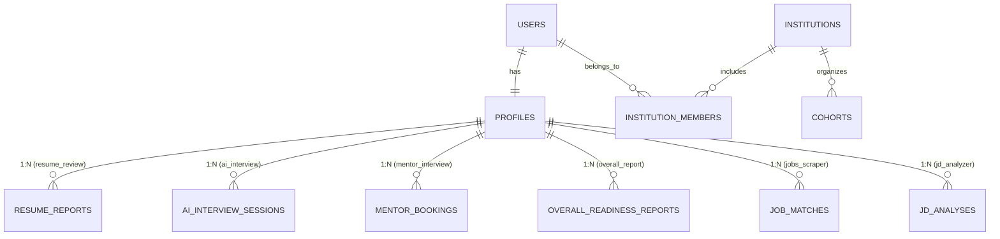

# System Patterns — PrepPilot

## High-Level Microservice Architecture

PrepPilot is built as a **Microservice-Oriented Architecture** designed for high scalability, domain isolation, and modular team development while maintaining a $0 free-tier hosting footprint.

```
                                  ┌───────────────────────────────┐
                                  │   Next.js 16 Client Portal    │
                                  │      (App Router, UI)         │
                                  └───────────────┬───────────────┘
                                                  │ REST / SSE
                                                  ▼
                                  ┌───────────────────────────────┐
                                  │  API Gateway & Auth Router    │
                                  │  (JWT verify, Rate limiting)  │
                                  └───────┬───────────────┬───────┘
                                          │               │
     ┌───────────────────┬────────────────┼───────────────┼───────────────────┬───────────────────┐
     ▼                   ▼                ▼               ▼                   ▼                   ▼
┌──────────────┐  ┌──────────────┐ ┌──────────────┐ ┌──────────────┐   ┌──────────────┐   ┌──────────────┐
│  1. Mentor   │  │    2. AI     │ │  3. Resume   │ │  4. Overall  │   │ 5. Suggested │   │  6. JD &     │
│  Interview   │  │  Interview   │ │    Review    │ │    Report    │   │ Jobs Scraper │   │  Interview   │
│   Service    │  │   Service    │ │  (Isolated)  │ │   Service    │   │   Service    │   │    Design    │
└──────┬───────┘  └──────┬───────┘ └──────┬───────┘ └──────┬───────┘   └──────┬───────┘   └──────┬───────┘
       │                 │                │                │                  │                  │
       └─────────────────┴────────────────┼────────────────┴──────────────────┴──────────────────┘
                                          │
                                          ▼
                         ┌─────────────────────────────────┐
                         │    7. Connected Teams Prep      │
                         │    (University/Cohorts B2B)     │
                         └────────────────┬────────────────┘
                                          │
                                          ▼
                      ┌───────────────────────────────────────┐
                      │    PostgreSQL Database (Supabase)     │
                      │  - Shared: users, profiles, teams     │
                      │  - Dedicated table per microservice   │
                      └───────────────────────────────────────┘
```

---

## The 7 Core Microservices

1. **Mentor Interview Service** (`/backend/app/services/mentor_interview`)
   - Mentor application, credential verification, admin approval.
   - Weekly availability slot calendar, candidate booking flow.
   - Embedded Jitsi video rooms (`preppilot-mentor-<booking_id>`).
   - Structured mentor-authored rubric feedback (Communication, Technical, Problem Solving).
   - Tables: `mentor_profiles`, `mentor_availability`, `mentor_bookings`, `mentor_feedbacks`.

2. **AI Mock Interview Service** (`/backend/app/services/ai_interview`)
   - 24/7 adaptive mock interview loop (voice and text).
   - Dynamic follow-up generation using Gemini 2.0 Flash + Groq fallback.
   - Question adaptation based on candidate profile and resume gaps.
   - Real-time scoring and comprehensive session feedback report.
   - Tables: `ai_interview_sessions`, `ai_interview_turns`.

3. **Resume Review Service** (`/backend/app/services/resume_review`) — *Isolated & Working*
   - PDF extraction via `pypdf`.
   - ATS compatibility scoring (0-100) across 4 pillars: Impact & Metrics, Technical Depth, ATS Readability, Structure & Brevity.
   - Line-by-line actionable before/after bullet revisions.
   - Skill extraction and interview topic recommendations.
   - Tables: `resume_reports`.

4. **Overall Report Service** (`/backend/app/services/overall_report`)
   - Unified candidate readiness intelligence engine.
   - Aggregates Resume ATS scores + AI Mock session performance + Mentor reviews.
   - Computes **PrepPilot Readiness Index (0-100)** and multi-axis competency radar (DSA, System Design, Communication, Problem Solving, Tooling).
   - Longitudinal progress trends tracking candidate growth over time.
   - Tables: `candidate_readiness_reports`, `competency_history`.

5. **Suggested Jobs Scraper Service** (`/backend/app/services/job_scraper`)
   - Web scraper aggregating active tech job listings.
   - Compares candidate `profiles.skills` with live job requirements.
   - Computes **Match Percentage (%)** and highlights missing critical qualifications.
   - Tables: `scraped_jobs`, `candidate_job_matches`.

6. **JD Analyzer & Custom Interview Designer** (`/backend/app/services/jd_analyzer`)
   - Analyzes raw Job Descriptions pasted by candidates for specific target companies.
   - Extracts essential competencies, system requirements, and tech stack expectations.
   - Designs a tailored interview question blueprint directly targeting that specific job.
   - Direct launch bridge into Service 2 (AI Mock Interview).
   - Tables: `job_descriptions`, `custom_interview_blueprints`.

7. **Connected Teams Preparation Service** (`/backend/app/services/teams_prep`)
   - Institutional B2B portal for universities, placement cells, and bootcamps.
   - Student cohort management and placement batch tracking.
   - Aggregated cohort readiness dashboards and cohort-wide skill gap analytics.
   - Exportable placement reports for college administration.
   - Tables: `team_cohorts`, `cohort_members`, `cohort_analytics`.

---

## Supporting Infrastructure Services

8. **API Gateway & Auth Router** (`/backend/app/gateway` / `main.py`):
   - Centralized Supabase JWT verification.
   - Request routing to respective microservices.
   - Global rate-limiting to protect free-tier Gemini/Groq quotas.
   - Standard `{ "data": ..., "error": null }` envelope enforcement.

9. **Notification & Email Worker** (`/backend/app/services/notifications`):
   - Asynchronous email dispatch via Resend (free tier, 100 emails/day).
   - Booking confirmation, 1-hour session reminder, feedback ready alerts.

10. **Async Background Worker**:
    - Non-blocking task execution for web job scrapers and batch university cohort analytics.

---

## Database Architecture: Shared Core + Dedicated Service Tables

All services interact through a shared PostgreSQL instance (Supabase) using a clean schema separation pattern:



### Shared Core Tables (`/backend/app/models/user.py`)
- **`users`**: `id`, `email`, `role` (`candidate` | `mentor` | `team_admin` | `super_admin`), `full_name`, `created_at`
- **`profiles`**: `id`, `user_id` (FK `users.id`), `full_name`, `avatar_url`, `target_role`, `experience_level`, `bio`, `target_companies` (JSON), `skills` (JSON), `created_at`, `updated_at`
- **`institutions`**: `id`, `name`, `type` (`university` | `bootcamp` | `corporate`), `admin_user_id`, `created_at`
- **`institution_members`**: `id`, `institution_id`, `user_id`, `batch_name`, `status`, `joined_at`

### Dedicated Service Tables (Owned per Microservice)
- **Resume Review**: `resume_reports` (FK `profile_id`, `user_id`)
- **AI Interview**: `ai_interview_sessions`, `ai_interview_turns` (FK `user_id`)
- **Mentor Interview**: `mentor_profiles`, `mentor_availability`, `mentor_bookings`, `mentor_feedbacks`
- **Overall Report**: `candidate_readiness_reports`, `competency_history` (FK `user_id`)
- **Jobs Scraper**: `scraped_jobs`, `candidate_job_matches` (FK `user_id`, `job_id`)
- **JD Analyzer**: `job_descriptions`, `custom_interview_blueprints` (FK `user_id`)
- **Teams Prep**: `team_cohorts`, `cohort_members`, `cohort_analytics` (FK `institution_id`)

---

## Microservice Directory Pattern

Every service follows this strict internal layout:
```
/backend/app/services/<service_name>/
  __init__.py       # Exports public router, service methods, and models
  api.py            # APIRouter with thin HTTP route definitions
  service.py        # Core domain logic & external integrations
  models.py         # Service-specific SQLAlchemy database models
  schemas.py        # Pydantic request/response schemas
```

This guarantees 100% domain isolation while allowing zero-cost execution on Render/Railway.
